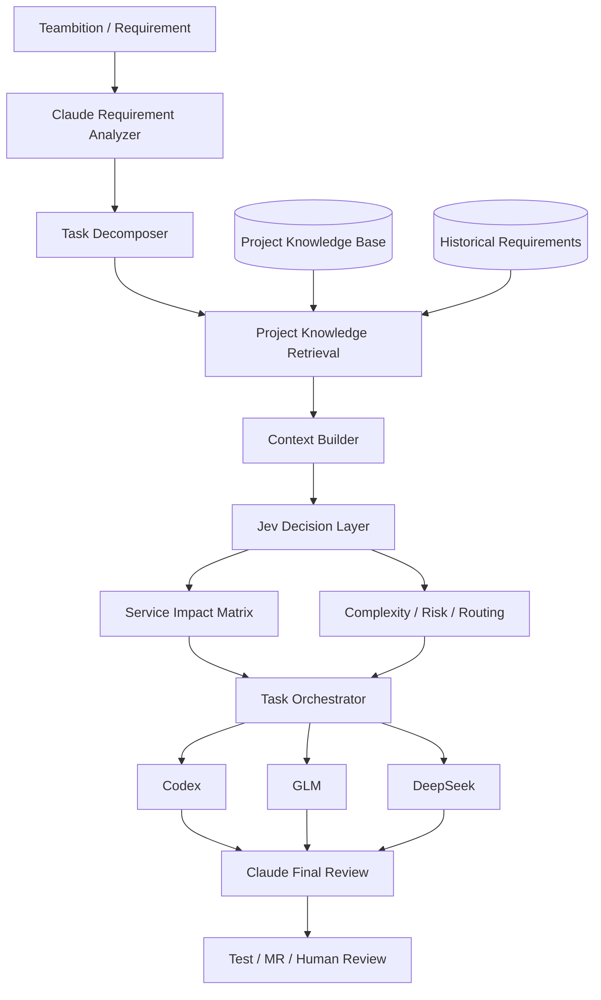

# 从项目知识库到 AI 研发调度：用 Claude、Jev 与 Codex 做微服务需求影响分析

在微服务项目里，真正耗时间的往往不只是“把代码写出来”。

一个看起来很小的需求，可能同时涉及生产订单、机台任务、报工、Web、App、数据库以及多个后端服务。开发之前，首先要回答一堆问题：

- 这个需求到底影响哪些微服务？
- 哪些模块一定要改，哪些只是可能受影响？
- 是否涉及数据库、历史数据、权限、接口兼容？
- 应该把哪些任务交给更强的 Coding Agent？
- 哪些简单任务可以交给成本更低的模型？
- AI 自动判断到什么程度以后，必须交给人工或高级模型复核？

我最近在尝试把这些问题拆成一个更清晰的 AI 研发工作流。

核心思路可以总结成一句话：

> **项目知识库负责长期记忆，Claude 负责理解，Jev 负责判断，Codex 等 Coding Agent 负责执行。**

这篇文章记录的是一个仍处于 PoC 阶段的架构探索：如何把自建项目知识库、Claude、TypeSafe Jev 和 Codex 等工具组合起来，构建一个面向多微服务研发场景的 **Requirement Orchestrator（需求智能编排器）**。

---

## 1. 为什么需要“需求影响分析”这一层

传统 AI 辅助开发通常是：

```text
需求
  ↓
Claude / Codex
  ↓
分析代码
  ↓
直接修改
```

对于单仓库、小项目，这种方式已经很好用。

但在十几个甚至几十个微服务并行的系统里，问题会复杂很多。

例如一个需求：

> 机台任务增加“任务剩余报工数量”，Web 和 App 都需要展示，报工完成后实时更新，并兼容历史数据。

真正开始做之前，需要先判断：

```text
是否涉及 machine-task-service？
是否涉及 report-service？
是否涉及 production-service？
Web 是否需要改？
App 是否需要改？
数据库是否需要调整？
历史数据是否需要补偿？
接口是否有兼容风险？
```

这些问题并不一定需要一个大模型写几百字分析，但又不能简单用 `if/else` 判断。

它们更接近：

> **基于项目上下文，对一组候选项进行语义判断。**

这正是我开始关注 TypeSafe Jev 的原因。

---

## 2. Jev 是什么：不是聊天模型，而是“判断层”

TypeSafe 把 Jev 定位为它的第一款公开 System One Model。

和 ChatGPT、Claude 这类生成式模型不同，Jev 的主要目标不是生成自然语言，而是输出软件可以直接消费的结构化判断和概率。

它提供三类核心 primitive：

| Primitive | 用途 | 例子 |
|---|---|---|
| `Noul` | 判断某个条件是否成立 | 这个需求是否涉及 report-service？ |
| `Choice` | 从互斥选项中选择一个 | 这个缺陷最可能属于前端、后端还是 App？ |
| `Score` | 在有序等级中评分 | 这个任务的复杂度是低、中还是高？ |

例如：

```json
{
  "impact_report_service": {
    "type": "noul",
    "instructions": "Does this requirement require changes to report-service?",
    "criteria": {
      "true": "The requirement changes reporting records, qualified quantity calculations, report aggregation, or APIs owned by report-service.",
      "false": "The requirement does not require changing behavior owned by report-service."
    }
  }
}
```

它不是返回一段：

```text
Based on the requirement, I think report-service may be involved because...
```

而是返回类似：

```text
true  89%
false 11%
```

对自动化系统来说，这种输出比长文本更容易参与后续控制逻辑。

---

## 3. 为什么不是所有事情都交给 Claude

Claude 很适合做复杂理解。

例如它能理解：

> “任务剩余报工数量 = 任务数量 - 已报合格数量”

然后结合项目文档和代码判断这里存在“机台任务”和“报工”两个业务域。

但如果后面还有 20 个候选服务，需要逐个判断：

```text
service-A 是否受影响？
service-B 是否受影响？
service-C 是否受影响？
……
```

继续让高级大模型承担所有判断并不一定划算。

更合理的职责拆分是：

```text
Claude
  └─ 需求理解
  └─ 任务拆解
  └─ 找候选模块
  └─ 最终总审核

Jev
  └─ 服务影响判断
  └─ 风险评分
  └─ 难度分类
  └─ Agent 路由
  └─ 是否需要人工升级

Codex / 其他 Coding Agent
  └─ 真正分析源码
  └─ 修改代码
  └─ 测试
```

这不是“谁替代谁”，而是把不同类型的工作交给更适合的模型。

---

## 4. 整体架构

我目前设想的第一版架构如下：



这里最重要的一点是：

> **Jev 不直接读取整个项目，也不负责自己寻找所有知识。**

它前面必须有一个 Context Builder。

---

## 5. 项目知识库才是整个系统的底座

如果直接问 Jev：

> “这个需求涉及哪些微服务？”

但 Jev 根本不知道公司内部：

- 有哪些微服务；
- 每个服务负责什么；
- 哪些接口属于哪个项目；
- 哪些数据库表归谁；
- 服务之间怎么调用；

那它只能依赖通用语义猜测。

因此第一版真正需要准备的不是“训练 Jev”，而是建设一份可靠的项目知识。

我的项目本身已经有一套自建知识库，因此最合适的方式不是重新维护第二套数据，而是：

```text
现有项目知识库
      ↓
RAG / Retrieval
      ↓
结构化项目上下文
      ↓
Context Builder
      ↓
Jev
```

---

## 6. 知识库最值得优先沉淀什么

第一阶段没必要把整个代码仓库都“知识化”。

对于需求影响分析，最有价值的是下面几类数据。

### 6.1 Service Catalog

描述每个服务负责什么。

```yaml
machine-task-service:
  responsibilities:
    - 机台任务
    - 任务数量
    - 任务状态
    - 机台任务查询
  tables:
    - machine_task
    - machine_task_detail
  dependencies:
    - report-service
    - production-service
```

### 6.2 Module Catalog

从“业务模块”映射到项目。

```yaml
机台任务:
  services:
    - machine-task-service
  frontend:
    - web-admin
  app:
    - mobile-app

报工:
  services:
    - report-service
  related_services:
    - machine-task-service
```

### 6.3 API Ownership

```yaml
/machine/task/list:
  owner: machine-task-service
  module: 机台任务

/production/report:
  owner: report-service
  module: 报工
```

### 6.4 Table Ownership

```yaml
machine_task:
  owner: machine-task-service

production_report:
  owner: report-service
```

### 6.5 Dependency Graph

```text
web-admin
   ↓
machine-task-service
   ↓
report-service
   ↓
database
```

### 6.6 历史需求真实改动范围

这一类数据尤其重要。

例如：

```yaml
requirement: 任务剩余报工数量
actual_changes:
  services:
    - machine-task-service
    - report-service
  frontend:
    - web-admin
  app:
    - mobile-app
  database_changed: false
```

Service Catalog 告诉 AI：

> “理论上谁负责什么。”

历史需求则告诉 AI：

> “现实里类似需求最终真的改过什么。”

后者非常适合用于后续离线评估。

---

## 7. 不要把整个知识库直接塞给 Jev

一个容易踩的坑是：

```text
需求
+
所有微服务文档
+
所有历史需求
+
所有数据库说明
+
几万行代码
      ↓
Jev
```

这不是我想要的架构。

更合理的是先通过检索缩小范围。

假设需求是：

> 机台任务增加剩余报工数量。

知识库先检索：

```text
机台任务
报工
任务数量
合格数量
剩余数量
```

返回：

```text
machine-task-service
- 负责机台任务
- 持有 taskQuantity
- 依赖 report-service

report-service
- 负责报工
- 持有 qualifiedQuantity

web-admin
- 包含机台任务列表

mobile-app
- 包含机台任务详情
```

然后 Context Builder 组装一个小而清晰的 state：

```json
{
  "requirement": "机台任务增加任务剩余报工数量，Web 和 App 展示，报工后实时更新。",
  "candidate_services": {
    "machine-task-service": {
      "responsibilities": ["机台任务", "任务数量", "任务状态"],
      "dependencies": ["report-service"]
    },
    "report-service": {
      "responsibilities": ["报工", "合格数量", "报工记录"]
    }
  },
  "clients": {
    "web-admin": ["机台任务列表"],
    "mobile-app": ["机台任务详情"]
  }
}
```

然后才交给 Jev。

---

## 8. 多服务影响分析为什么不应该用一个 Choice

假设候选服务有：

```text
machine-task-service
report-service
production-service
base-service
```

如果使用：

```text
Which service should handle this requirement?
```

然后做一个 `Choice`，意味着它们是互斥的。

但真实需求完全可能：

```text
machine-task-service 需要改
report-service 也需要改
Web 需要改
App 需要改
```

因此多模块影响分析更适合：

> **一个候选服务对应一个独立 Noul。**

例如：

```json
{
  "impact_machine_task": {
    "type": "noul",
    "instructions": "Does this requirement require changes to machine-task-service?",
    "criteria": {
      "true": "The requirement changes machine task business logic, state, quantities, query results, or APIs owned by machine-task-service.",
      "false": "No behavior owned by machine-task-service needs to change."
    }
  },

  "impact_report_service": {
    "type": "noul",
    "instructions": "Does this requirement require changes to report-service?",
    "criteria": {
      "true": "The requirement changes reporting records, qualified quantity calculation, report aggregation, or report-service APIs.",
      "false": "No behavior owned by report-service needs to change."
    }
  }
}
```

最终形成：

```text
machine-task-service   96%
report-service         89%
production-service     31%
base-service            8%
web-admin              99%
mobile-app             98%
```

这就是我希望得到的 **Service Impact Matrix**。

---

## 9. 影响矩阵只是第一层

Jev 不应该只回答“改哪里”。

同一个 RequirementContext 可以继续问：

### 是否涉及数据库

```text
Does this task require a database schema or data migration change?
```

### 是否涉及历史数据

```text
Does this task require special handling for existing historical records?
```

### 是否跨服务

```text
Does this task require behavior changes across multiple backend services?
```

### 难度

使用 `Score`：

```json
{
  "complexity": {
    "type": "score",
    "instructions": "How difficult and risky is this development task?",
    "criteria": [
      "Simple: isolated data, field, SQL or configuration change with little dependency impact.",
      "Medium: normal business logic change involving one or two modules with clear requirements.",
      "Complex: cross-service logic, transactions, concurrency, legacy compatibility or high production risk."
    ]
  }
}
```

这样可以得到：

```json
{
  "service_impact": {
    "machine-task-service": 0.96,
    "report-service": 0.89,
    "production-service": 0.31
  },
  "web": 0.99,
  "app": 0.98,
  "database_change": 0.21,
  "historical_data": 0.87,
  "complexity": "complex"
}
```

---

## 10. 从需求影响分析走向“模型路由”

有了复杂度和风险判断以后，可以继续做一层 Agent Routing。

这是我目前比较感兴趣的一种分工方式：

```text
高复杂度 / 跨服务 / 高风险
            ↓
          Codex

普通业务修改
            ↓
           GLM

简单 SQL / 数据 / 配置类任务
            ↓
        DeepSeek

所有结果
            ↓
         Claude
       最终总审核
```

伪代码：

```java
if (task.isHighRisk() || task.getComplexity() == COMPLEX) {
    dispatchToCodex(task);
} else if (task.getComplexity() == MEDIUM) {
    dispatchToGlm(task);
} else {
    dispatchToDeepSeek(task);
}
```

但最终路由不应该只依赖一个“难度”。

更合理的是综合：

```text
复杂度
+ 跨服务数量
+ 是否涉及数据库
+ 是否涉及历史数据
+ 是否涉及事务/并发
+ Jev 置信度
```

---

## 11. Claude 在整个系统中的角色

我目前不会让 Jev 负责从零拆复杂需求。

这一层仍然更适合 Claude。

例如原始需求：

> 机台任务增加剩余报工数量，Web 和 App 都需要展示，报工后实时更新，同时需要兼容历史任务。

Claude 可以先拆成：

```text
T1 定义剩余数量计算规则
T2 后端查询接口增加字段
T3 处理报工后实时刷新逻辑
T4 Web 增加字段
T5 App 增加字段
T6 检查历史数据兼容
T7 增加测试
```

每个 TaskUnit 再进入：

```text
知识库检索
   ↓
Jev Impact Analysis
   ↓
Agent Routing
```

最后所有 Agent 完成以后，再让 Claude 回到“需求级别”做一次审核：

```text
原始需求有没有漏？
Web 是否完成？
App 是否完成？
历史数据是否考虑？
接口是否兼容？
跨服务改动是否一致？
测试是否覆盖？
```

因此：

> **Claude 是 Requirement-level reasoning，Jev 是 Decision-level intelligence。**

---

## 12. TypeSafe Skill 在 Claude Code / Coding Agent 中的意义

TypeSafe 官方已经提供 Agent Skill。

在 Claude Code 中，可以通过官方 plugin 安装：

```bash
claude plugin marketplace add typesafe-ai/skills
claude plugin install typesafe@typesafe-ai
```

然后可以显式使用：

```text
/typesafe:typesafe-ai
```

TypeSafe Skill 本身不是“把 Jev 塞进 Claude”。

它更像是给 Coding Agent 一份 TypeSafe 的使用说明和工程模式，让 Agent 知道：

- 什么场景应该用 TypeSafe；
- 怎么选择 Noul / Choice / Score；
- 怎样设计 state；
- 怎样处理概率和阈值；
- 怎样设计 human review。

对于支持 Agent Skills 的其他环境，也可以安装对应 skill。

这意味着 Requirement Orchestrator 的第一版甚至不需要先做一个完整 Java 编排系统。

可以先直接做：

```text
Claude Code
   + 项目知识库
   + TypeSafe Skill
   + Jev API
```

快速验证“需求 → 服务影响矩阵”是否值得继续投入。

---

## 13. Codex 也能参与 Skill 工作流

Codex 目前也支持 Agent Skills。

因此同一套项目知识，不一定只能服务 Claude。

未来可以把仓库里的 AI 工程规则组织成：

```text
repo/
├─ AGENTS.md
├─ .agents/
│  └─ skills/
│     ├─ requirement-impact/
│     ├─ typesafe-ai/
│     └─ project-knowledge/
└─ ...
```

这样 Codex 的角色可以变成：

```text
TaskUnit
  ↓
读取 repo-local skill
  ↓
读取项目上下文
  ↓
必要时使用 Jev 做结构化判断
  ↓
修改代码
  ↓
测试
```

从长期看，我更希望项目知识、研发流程和 Agent 规则成为仓库的一部分，而不是存在于某一个人的 Prompt 历史里。

---

## 14. 第一阶段怎么验证，而不是直接“上生产”

这类系统最危险的是：

> Demo 看起来很聪明，然后直接开始自动改代码。

我准备采用完全相反的方式。

第一阶段只做 **离线验证**。

从已经完成的历史需求中选 10～20 个：

```text
历史需求
  ↓
知识库检索
  ↓
Claude + Jev
  ↓
预测影响服务
```

然后拿结果和真实 Git 改动范围比较：

```text
预测：
machine-task-service
report-service
web-admin

实际：
machine-task-service
report-service
web-admin
```

先看影响分析本身是否有价值。

---

## 15. 建议关注的指标

不能只看“AI 说得像不像”。

至少记录：

### Recall

真实应该修改的服务，有多少被识别出来。

对需求影响分析来说，我认为 Recall 往往比 Precision 更重要。

漏掉一个关键服务的代价，可能比多检查一个服务更大。

### Precision

预测需要修改的服务中，真正需要修改的比例。

### Top-k Coverage

真实修改服务是否落在概率最高的前几个候选项。

### False Negative

这是我最关注的一项：

```text
真实需要改
但 AI 判断为不需要改
```

### Confidence Calibration

例如：

```text
预测概率 > 90% 的判断
实际到底有多少真的正确？
```

如果概率无法对应可靠性，就很难设计自动化阈值。

---

## 16. Human-in-the-loop 仍然必不可少

我的目标不是：

```text
AI 判断
  ↓
直接改所有项目
  ↓
自动上线
```

而是：

```text
高置信度 + 低风险
        ↓
自动进入开发队列

中置信度
        ↓
Claude 二次审核

低置信度 / 高风险
        ↓
人工确认
```

例如：

```java
if (impactProbability >= 0.90 && risk == LOW) {
    autoPlan();
} else if (impactProbability >= 0.65) {
    claudeReview();
} else {
    humanReview();
}
```

具体阈值不能拍脑袋决定。

它应该从历史需求评估数据里慢慢校准。

---

## 17. 哪些事情不应该交给 Jev

这一点也很重要。

如果规则本身是确定性的：

```text
用户有没有某个权限
某字段是不是 NULL
订单状态是否等于 Completed
数量是否大于 0
```

直接使用 Java / SQL。

```java
if (user.hasPermission("EDIT")) {
    ...
}
```

没有必要让模型判断。

我的原则是：

> **确定性事实交给代码，模糊语义判断交给模型。**

这也符合我对整个架构的定位：

```text
Java / SQL
= hard rules

Project Knowledge Base
= facts and memory

Claude
= reasoning

Jev
= probabilistic judgments

Coding Agents
= execution
```

---

## 18. 从 Requirement Orchestrator 再往前一步

如果“需求影响分析”验证成功，后面可以逐渐扩展：

### Teambition 自动接入

```text
新需求
  ↓
自动抓取
  ↓
分析影响范围
  ↓
生成 Task Graph
```

### 缺陷 Triage

一个缺陷不再强制前端 / 后端 / App 三选一。

先判断：

```text
observed_surface
suspected_owner
need_more_information
```

低置信度进入“待定位”。

### 自动补充上下文

缺陷缺少：

```text
API Response
Console Error
Trace ID
Backend Log
```

就先要求补充证据，再做第二次判断。

### 自动模型选择

```text
复杂跨服务 → Codex
普通开发 → GLM
简单任务 → DeepSeek
```

### Git Diff 回流知识库

需求完成以后，把真实改动：

```text
服务
模块
接口
表
原因
测试结果
```

重新写回项目知识库。

最终形成：

```text
需求
 ↓
预测
 ↓
开发
 ↓
真实改动
 ↓
知识库
 ↓
下一次预测更有依据
```

---

## 19. 最终想做成什么

我想要的并不是“让 AI 多写一点代码”。

真正想解决的是：

> **让 AI 逐渐理解一个长期演化的项目，并参与研发流程中的判断、调度和执行。**

最终可能形成：

```text
                  ┌───────────────────────┐
                  │ Project Knowledge Base│
                  └───────────┬───────────┘
                              │
Requirement ──→ Claude ──→ Context Builder
                              │
                              ▼
                             Jev
                    ┌─────────┼──────────┐
                    ▼         ▼          ▼
                Impact     Complexity   Risk
                    └─────────┼──────────┘
                              ▼
                         Orchestrator
                  ┌───────────┼───────────┐
                  ▼           ▼           ▼
                Codex        GLM       DeepSeek
                  └───────────┼───────────┘
                              ▼
                         Claude Review
                              ▼
                       Human / Test / MR
                              ▼
                       Knowledge Feedback
```

这里每一个模型只做自己擅长的事情。

这比“用一个最强模型包办所有事情”更像一个真正的软件系统。

---

## 20. 当前阶段的结论

目前这套架构仍然是探索阶段。

Jev 是否真的适合微服务需求影响分析，不能靠几次 Playground Demo 下结论。

真正值得做的是：

1. 整理服务职责和模块归属；
2. 把现有项目知识库变成可靠 Context Source；
3. 选择一批已经完成的历史需求；
4. 让 Claude + Jev 预测影响范围；
5. 与真实 Git 改动做离线对比；
6. 评估 Recall、Precision 和 False Negative；
7. 再决定是否继续做自动任务拆分和多模型路由。

但至少从架构方向上，我越来越确定一件事：

> **未来 Coding Agent 的竞争，不只是模型本身有多强，而是谁能获得更好的项目上下文，以及谁能把“理解、判断、执行、验证”拆成可靠的工程流程。**

项目知识库解决“记得住”。

Claude 解决“看得懂”。

Jev 解决“怎么判断”。

Codex 等 Agent 解决“真正去做”。

如果这几个环节最终能够稳定协作，那么 AI 辅助研发可能就不再只是一个聊天窗口，而会逐渐变成研发系统本身的一部分。

---

## 参考资料

- TypeSafe AI — System One / Jev 官方介绍
- TypeSafe AI — Agent Skills 官方仓库
- TypeSafe AI — System One API / primitives 文档
- OpenAI Developers — Agent Skills / Codex Skills 文档

> 注：本文记录的是个人技术探索和 PoC 架构，不代表生产环境已经验证完成。文中的服务名称、业务名称和示例均为抽象化表达。
